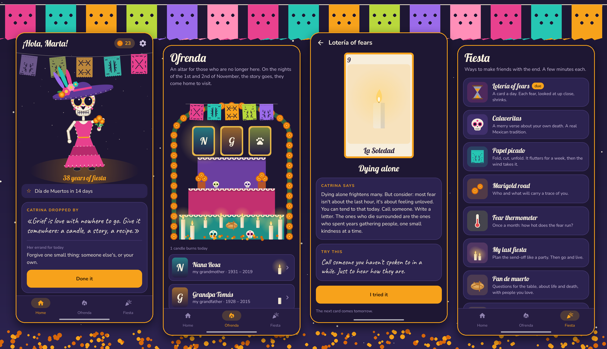

<div align="center">


# Calavera

### Memento mori, with marigolds.

*A merry little app about death and growing old, in the spirit of the Mexican Day of the Dead. Dress your skeleton, build an altar for the ones you miss, draw a card for each fear, write a funny verse about your own funeral. Free, no ads, no account.*

[](https://github.com/bigdevwhale/calavera/actions/workflows/android.yml)
[](https://github.com/bigdevwhale/calavera/releases/latest)


[](LICENSE)

**English** · [Русский](README.ru.md) · [Changelog](CHANGELOG.md)



</div>

---

## The idea

Most of us were taught to look away from death, so it waits in the corner and grows. In Mexico, on the first nights of November, people do the opposite: they build altars, dress up as skeletons, eat sugar skulls and write funny poems about their own funerals. Death becomes a guest at the party instead of a monster under the bed.

Calavera brings that spirit to a phone. A few minutes a day, with colour and jokes, to make the end a little less frightening and the years a little brighter. Ageing is treated as an upgrade, not a loss.

## Your calaca

The home screen is you, without the skin: a skeleton that sways under a night sky and dances when tapped. Dress it from the wardrobe: flower crowns, sombreros, Catrina's hat, a charro suit, a fiesta dress, a guitar, maracas, five face paints in five colours. Clothes are bought with **marigold petals**, earned by the practices.

Some things can't be bought. Glasses, a cane, a rebozo shawl and a gold tooth are **privileges of years**: Catrina brings the next one on each birthday. You arrive with one for each decade past thirty.

## What's inside

| | Feature | How it works |
|---|---|---|
| 💀 | **Catrina's visit** | Every day a word from La Catrina ("A wrinkle is where a smile has been") and a small errand: look at the sky for a minute, call a grandparent, eat something slowly. One quiet notice a day, at the hour you choose. |
| 🕯️ | **The ofrenda** | A drawn altar under an arch of marigolds. Put up the people and pets you miss, with a photo or a painted card, set out what they loved (coffee, pan de muerto, music, a cigar…), light a candle once a day and keep their memories. On the 31st of October to the 2nd of November the altar glows. |
| 🃏 | **Lotería of fears** | Twelve cards, one a day: El Olvido (being forgotten), La Nada (nothingness), El Reloj (running out of time), El Espejo (the face in the mirror)… Turn the card over for Catrina's take on that fear and a two-minute exercise. Collect the deck. |
| ✍️ | **Calaveritas** | Write a calaverita literaria, the traditional funny verse in which Death comes for someone, about yourself. Start from Catrina's examples, then share it as a card with papel picado and your calaca. |
| ✂️ | **Papel picado** | Fold the tissue in half or in four, cut it with your finger, unfold it. It hangs on the garland over your calaca for a week, fading and drooping, then the wind takes it. Impermanence you can hold. |
| 🌼 | **Marigold road** | Irvin Yalom's "rippling": each marigold is someone or something that will carry a trace of you. The road grows. |
| 🌡️ | **Fear thermometer** | Eight statements once a month; watch the temperature fall. |
| 🎉 | **My last fiesta** | Plan the send-off like a party: music, food, who speaks, how to be remembered, wishes about care, where the papers are. Share it as text when you're ready. |
| 🍞 | **Pan de muerto** | Thirty questions for the table, to talk about life and death with family. Pass the phone round. |
| 👵 | **Fiesta of the elders** | People who did their best work late, and Becca Levy's finding that those who think well of ageing live about 7.5 years longer. |
| 💾 | **Backup** | One zip with the ofrenda and its photos, verses, flags, readings, wardrobe and plan. |

## Care

Calavera is for making peace with mortality someday, not for hurrying it. If something written in the app sounds like the dark thoughts are about now, it gently suggests talking to someone and links to [findahelpline.com](https://findahelpline.com). The same link is always in the settings.

## Privacy

No account, no analytics, no ads, no network at all. Photos for the altar are copied into the app's own storage. Everything stays on the phone.

## Build

```bash
./gradlew assembleDebug                 # app.calavera.dev
./gradlew assembleDebug -Pdemo          # app.calavera.demo with Marta, her altar and a month of practice
./gradlew testDebugUnitTest -Prender    # draws the outfits, the altar, the cards and the screens to app/build/art
python tools/icon.py                    # the launcher icon and docs/logo.png
bash tools/capture.sh <dir> en|ru       # phone screenshots of the demo, then: python tools/shots.py <dir> docs/screenshots
```

Kotlin, Jetpack Compose, Room, DataStore. Every picture is drawn in code: the calaca and its wardrobe in `ui/art/Calaca.kt`, the altar, papel picado, candles, marigolds, offerings and lotería cards in `ui/art/Decor.kt`. Fonts: Lobster, Nunito and Caveat (SIL Open Font License).
