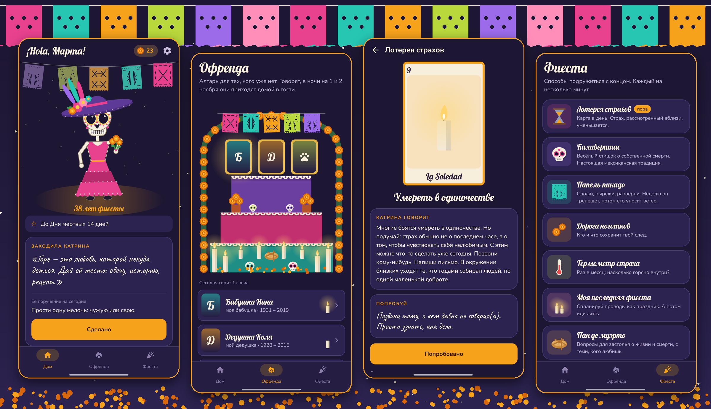

<div align="center">


# Calavera

### Memento mori, но с ноготками.

*Весёлое приложение о смерти и старении в духе мексиканского Дня мёртвых. Наряжай своего скелетика, строй алтарь для тех, по кому скучаешь, тяни карту для каждого страха, пиши смешные стихи о собственных похоронах. Бесплатно, без рекламы и аккаунта.*

[](https://github.com/bigdevwhale/calavera/actions/workflows/android.yml)
[](https://github.com/bigdevwhale/calavera/releases/latest)


[](LICENSE)

[English](README.md) · **Русский** · [Изменения](CHANGELOG.md)



</div>

---

## Идея

Большинство из нас приучили отводить взгляд от смерти, и она сидит в углу и растёт. В Мексике в первые ночи ноября делают наоборот: строят алтари, наряжаются скелетами, едят сахарные черепа и пишут смешные стихи о собственных похоронах. Смерть становится гостьей на празднике, а не чудовищем под кроватью.

Calavera приносит этот дух в телефон. Несколько минут в день, с цветом и шутками, чтобы конец стал чуть менее страшным, а годы чуть ярче. Старение здесь — апгрейд, а не потеря.

## Твоя калака

На главном экране ты, только без кожи: скелетик, который покачивается под ночным небом и танцует от касания. Наряжай его из гардероба: венки, сомбреро, шляпа Катрины, костюм чарро, праздничное платье, гитара, маракасы, пять росписей лица в пяти цветах. Одежда покупается за **лепестки ноготков**, которые дают практики.

Кое-что не купишь. Очки, трость, шаль-ребосо и золотой зуб — **привилегии лет**: Катрина приносит следующую на каждый день рождения. Новичок получает по одной за каждое десятилетие после тридцати.

## Что внутри

| | Функция | Как работает |
|---|---|---|
| 💀 | **Визит Катрины** | Каждый день слово от Ла Катрины («Морщинка — это место, где была улыбка») и маленькое поручение: минуту посмотреть на небо, позвонить бабушке, съесть что-нибудь медленно. Одно тихое уведомление в день в выбранный час. |
| 🕯️ | **Офренда** | Нарисованный алтарь под аркой из ноготков. Поставь тех, людей и питомцев, по кому скучаешь, с фото или расписной карточкой, положи то, что они любили (кофе, пан де муэрто, музыку, сигару…), зажигай свечу раз в день и храни воспоминания. С 31 октября по 2 ноября алтарь светится. |
| 🃏 | **Лотерея страхов** | Двенадцать карт, по одной в день: El Olvido (забвение), La Nada (небытие), El Reloj (нехватка времени), El Espejo (лицо в зеркале)… Переверни карту — там взгляд Катрины на этот страх и упражнение на две минуты. Собери колоду. |
| ✍️ | **Калаверитас** | Напиши калавериту — традиционный смешной стишок, где Смерть приходит за кем-то, — о себе. Начни с примеров Катрины и поделись открыткой с папель пикадо и своей калакой. |
| ✂️ | **Папель пикадо** | Сложи бумагу пополам или вчетверо, вырежи пальцем, разверни. Флажок висит на гирлянде над калакой неделю, выцветая и обвисая, а потом его уносит ветер. Непостоянство, которое можно подержать в руках. |
| 🌼 | **Дорога ноготков** | «Рябь» Ирвина Ялома: каждый ноготок — кто-то или что-то, что сохранит твой след. Дорога растёт. |
| 🌡️ | **Термометр страха** | Восемь утверждений раз в месяц; смотри, как падает температура. |
| 🎉 | **Моя последняя фиеста** | Спланируй проводы как вечеринку: музыка, еда, кто скажет речь, какой тебя запомнить, пожелания об уходе, где лежат документы. Поделись текстом, когда будешь готов(а). |
| 🍞 | **Пан де муэрто** | Тридцать вопросов для застолья, чтобы поговорить о жизни и смерти с семьёй. Передавайте телефон по кругу. |
| 👵 | **Фиеста старших** | Люди, сделавшие главное в поздние годы, и открытие Бекки Леви: те, кто хорошо относится к старению, живут примерно на 7,5 лет дольше. |
| 💾 | **Резервная копия** | Один zip с офрендой и её фото, стихами, флажками, измерениями, гардеробом и планом. |

## Забота

Calavera помогает примириться со смертностью когда-нибудь, а не торопить её. Если написанное в приложении звучит так, будто тёмные мысли касаются «сейчас», оно мягко предлагает поговорить с кем-нибудь и даёт ссылку на [findahelpline.com](https://findahelpline.com). Та же ссылка всегда есть в настройках.

## Приватность

Без аккаунта, аналитики, рекламы и вообще без сети. Фото для алтаря копируются во внутреннее хранилище приложения. Всё остаётся на телефоне.

## Сборка

```bash
./gradlew assembleDebug                 # app.calavera.dev
./gradlew assembleDebug -Pdemo          # app.calavera.demo с Мартой, её алтарём и месяцем практики
./gradlew testDebugUnitTest -Prender    # рисует наряды, алтарь, карты и экраны в app/build/art
python tools/icon.py                    # иконка и docs/logo.png
bash tools/capture.sh <dir> en|ru       # скриншоты демо с телефона, затем: python tools/shots.py <dir> docs/screenshots
```

Kotlin, Jetpack Compose, Room, DataStore. Вся графика нарисована кодом: калака и её гардероб в `ui/art/Calaca.kt`, алтарь, папель пикадо, свечи, ноготки, подношения и карты лотереи в `ui/art/Decor.kt`. Шрифты: Lobster, Nunito и Caveat (SIL Open Font License).
